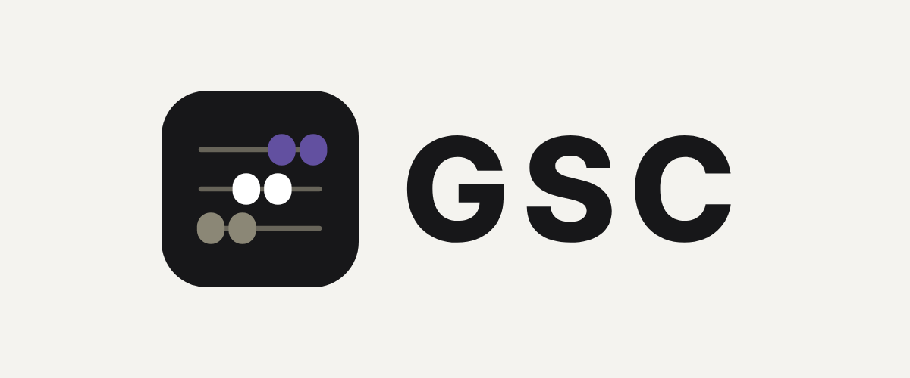

<p align="center">
  
</p>

# GSC

A personal budgeting web app. Set a budget for a day, a week, a month or a set number of days, list what you need to buy with the prices, and see what's left to spend each day.

**Live site:** https://yusuanc.netlify.app

## Features

- **Two-question setup:** how much your budget is, and whether it's for a day, a week, a month or a custom number of days. Each period starts fresh automatically when the next one begins.
- **Lists:** make a list for anything (groceries, a party, moving, school supplies) and add items with a quantity, unit and price. The list totals itself.
- **Tick items as you buy them:** a ticked item moves from "need to buy" to "spent" and is logged in your spending.
- **"Can I afford it?":** every list checks its remaining cost against what's left in your budget.
- **Costing:** optionally, work out cost per piece, profit, profit margin and suggested selling prices for things you make and sell.
- **Home screen:** what's left to spend, how much you can spend today, spent versus still to buy, and a warning when you're spending faster than planned.
- **History:** spending by month, with a breakdown by category.
- **Phone-first:** light and dark mode, and it can be added to your home screen like an app.

## How it works

GSC is a static site: one `index.html` with its HTML, CSS and JavaScript, plus a web app manifest and icons. There's no build step and no server code.

Your data is saved in your browser's local storage on your own device. Nothing is sent to a server. If you clear your browser data or switch devices, your budget starts fresh.

## Run it locally

Open `index.html` in a browser. To test it the way it runs online, serve the folder:

```bash
python3 -m http.server 8000
```

Then go to http://localhost:8000.

## Deploy

The site is hosted on [Netlify](https://www.netlify.com). To update it, upload the project files on the project's **Deploys** page, or connect this repository to Netlify so it redeploys whenever you push.

## Project files

| File | What it is |
|---|---|
| `index.html` | The whole app |
| `manifest.webmanifest` | App name, colors and icons for installing to the home screen |
| `icon-*.png`, `apple-touch-icon.png`, `icon.svg` | App icons |
| `assets/logo/` | Logo files: the icon, and the name with the icon on light and dark backgrounds |

## Colors

| Name | Hex |
|---|---|
| Muted Violet | `#6250A0` |
| Deep Charcoal | `#171719` |
| Warm Taupe | `#8B8776` |
| White | `#FFFFFF` |
